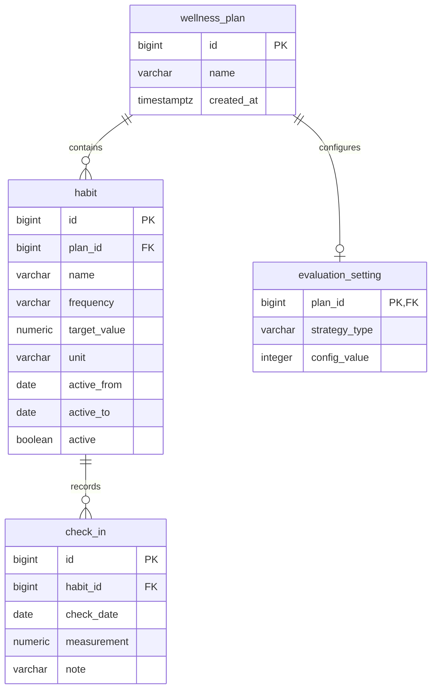

# Database Design

## 1. Entity Relationship Diagram

## 2. Relationships

### Wellness Plan and Habit

A wellness plan can contain zero or more habits.
Each habit belongs to exactly one existing plan.

The `habit.plan_id` foreign key references `wellness_plan.id`.

### Habit and Check-In

A habit can have zero or more check-ins.
Each check-in belongs to exactly one existing habit.

The `check_in.habit_id` foreign key references `habit.id`.

The combination of `habit_id` and `check_date` is unique.
This allows at most one check-in per habit per date.

### Wellness Plan and Evaluation Setting

The `evaluation_setting.plan_id` column is both the primary key
and a foreign key referencing `wellness_plan.id`.

The database permits zero or one evaluation-setting row per plan.

`WellnessPlanService.createPlan` creates a plan and its default
evaluation settings in the same transaction.

## 3. Data Type Decisions

| Data                     | Type          | Reason                                 |
| ------------------------ | ------------- | -------------------------------------- |
| Entity identifiers       | `BIGINT`      | Integer identifiers with a large range |
| Plan creation time       | `TIMESTAMPTZ` | Represents a creation instant          |
| Habit and check-in dates | `DATE`        | Calendar dates without a time of day   |
| Targets and measurements | `NUMERIC`     | Exact decimal storage                  |
| Habit status             | `BOOLEAN`     | Active or inactive state               |
| Names and notes          | `VARCHAR`     | Text with defined maximum lengths      |

The Java persistence layer uses `BigDecimal` for numeric measurements
and targets, `LocalDate` for calendar dates, and `Instant` for plan
creation timestamps.

## 4. Integrity Rules

| Rule                                                  | Enforcement       |
| ----------------------------------------------------- | ----------------- |
| A habit must reference an existing plan               | Foreign key       |
| A check-in must reference an existing habit           | Foreign key       |
| An evaluation setting must reference an existing plan | Foreign key       |
| One check-in per habit per date                       | Unique constraint |
| Nonblank names and units                              | Check constraints |
| Supported frequency and strategy values               | Check constraints |
| Positive, finite targets                              | Check constraint  |
| Nonnegative, finite measurements                      | Check constraint  |
| Habit end date cannot precede start date              | Check constraint  |
| Positive evaluation configuration value               | Check constraint  |
| Check-in date cannot be in the future                 | Check-in service  |
| Check-in date must be within the habit period         | Check-in service  |
| Adding or editing requires an active habit            | Check-in service  |

Service-level rules apply when callers use `CheckInService`.
They are not all enforced by direct SQL or repository calls.

## 5. Transaction Boundaries

Repositories borrow the caller's connection and execute SQL.

`Transactions.execute` opens a connection, disables auto-commit,
commits successful work, and rolls back failed work.

Creating a plan and its default evaluation settings is atomic:
both rows are committed together or neither is committed.

Check-in service mutations also run inside transactions.

## 6. Deletion Policy

Foreign keys prevent deletion of parent rows while dependent rows
still exist. Deletions do not cascade automatically.

When explicitly removing a complete plan and its data, the dependency
order is:

1. Delete check-ins belonging to the plan's habits.
2. Delete the plan's habits.
3. Delete the plan's evaluation settings.
4. Delete the plan.

These operations should share one transaction.

Deleting a single check-in does not delete its habit or plan.
